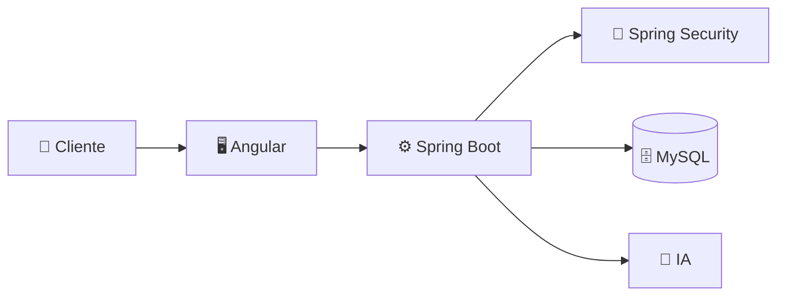

<h1 align="center">  Hi, I am ☆Davinchy☆  </h1>

Soy desarrollador de software y me apasiona crear sitios web visualmente atractivos y fáciles de usar. 

- 🤝 Me enfoco en clientes independientes, emprendedores y negocios que quieren dar el salto al mundo digital: creo soluciones web a su medida, con tecnología e IA para ayudarlos a crecer.
- 🚀 Creador de **Dahp Phad Studio**, un sistema de gestión de negocios con IA.
- 👨‍💻 Desarrollo aplicaciones web completas, desde la base de datos hasta la pantalla.
- 🐧 Dato curioso: mi sistema operativo favorito para desarrollar es **Arch Linux**.
- 🧩 Me gusta construir productos de principio a fin, con orden y código limpio.
- 🤖 Me gusta el desarrollo web + la integración con IA.
- 🌐 Creo sitios web visuales, atractivos y fáciles de usar.
- 🔐 Me enfoco también en seguridad web: autenticación y roles con Spring Security.
- 🎯 Mi meta: crear productos web con IA que resuelvan problemas reales.

<h2 align="center">💻 Habilidades</h2>
### Lenguajes

### Bases de Datos

### Tecnologías

### Redes y Contacto

<h2 align="center">🧠 Cómo construyo mis proyectos</h2>

<h2 align="center">🤝 Trabaja conmigo</h2>

| Servicio | Para quién | Qué recibes |
|---|---|---|
| 🌐 Página web a medida | Negocios nuevos | Un sitio rápido y fácil de usar |
| ⚙️ Sistema de gestión | Emprendedores | Control de tu negocio en un solo lugar |
| 🤖 Integración con IA | Negocios que quieren crecer | Tareas automáticas con inteligencia artificial |
| 🔐 Login y roles seguros | Cualquier proyecto | Usuarios protegidos con Spring Security |

📫 **Escríbeme:** dahpphadstudio@gmail.com

<h2 align="center">📂 Más sobre mí</h2>

🧭 ¿Cómo trabajo con un cliente?

1. Hablamos de lo que necesitas.
2. Te muestro una propuesta clara.
3. Construyo el proyecto y te voy mostrando avances.
4. Te lo entrego y te ayudo después.

🚀 ¿Qué es Dahp Phad Studio?

Un sistema de gestión de negocios con IA, pensado para clientes independientes.

